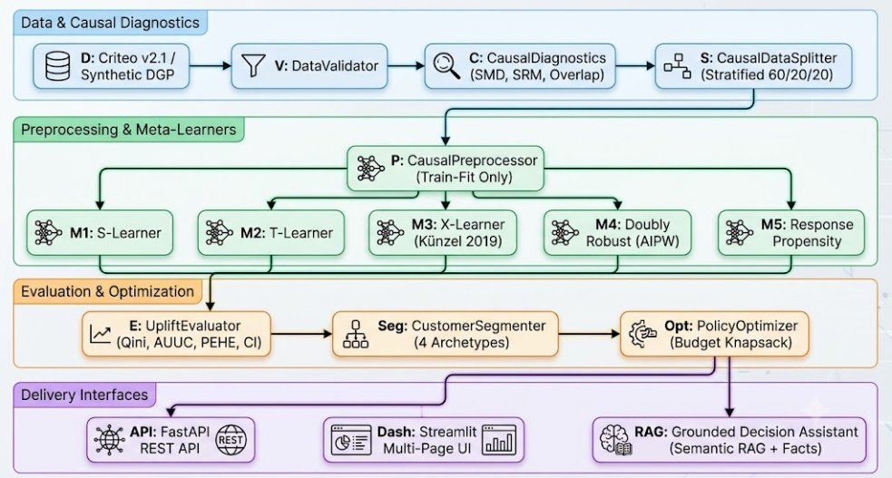

# DeltaCausal: Counterfactual Business Decision & Uplift Modeling Engine

[](https://www.python.org/downloads/)
[](https://fastapi.tiangolo.com/)
[](https://streamlit.io/)
[](https://creativecommons.org/licenses/by-nc-sa/4.0/)
[]()

**DeltaCausal** is a production-oriented causal inference and machine learning platform engineered to estimate the **incremental treatment impact** of marketing interventions, promotional discounts, and customer engagement policies under finite campaign budget constraints.

---

## 1. Business Problem & Causal Framing

Conventional marketing propensity models estimate:
$$P(\text{conversion} \mid \text{customer characteristics } X)$$

Targeting customers with the highest predicted purchase probability leads to substantial budget waste:
- **Sure Things**: Customers who convert organically without promotional incentives. Sending them discount codes needlessly erodes gross margins.
- **Lost Causes**: Disengaged users who will not convert regardless of outreach.
- **Sleeping Dogs**: Reactance-sensitive customers where promotional touchpoints trigger unsubscriptions or churn.

**DeltaCausal** reformulates targeting to estimate **Conditional Average Treatment Effects (CATE)**:
$$\tau(x) = E[Y(1) - Y(0) \mid X = x]$$

Where:
- $Y(1)$: Potential conversion outcome if the customer receives the promotional offer.
- $Y(0)$: Potential conversion outcome if the customer does not receive the offer.
- $\tau(x)$: Net incremental impact directly attributable to the intervention.

> **Fundamental Causal Caveat**: For any single customer, we observe only the realized outcome $Y = T \cdot Y(1) + (1-T) \cdot Y(0)$. Individual counterfactuals are unobservable. The engine estimates conditional subgroup expectations $\tau(x)$, supporting budget allocation rather than claiming deterministic individual certainty.

---

## 2. System Architecture

<p align="center">
  
</p>

---

## 3. Realized Benchmark Performance (Measured from Execution)

Results measured on held-out test data from experiment run `exp_20261030_133039` ($N=25,000$, Test $N=5,000$):

### Model Benchmark

| Model | Qini Score | AUUC | Top 20% Lift | Test Profit ($) | ROI (%) | PEHE (CATE Error) |
|:---|---:|---:|---:|---:|---:|---:|
| **T-Learner (Winning Model)** | **72.78** | **78.12** | **12.01%** | **$7,092.48** | **148.69%** | **0.0666** |
| Response Propensity Baseline | 70.44 | 65.45 | 13.10% | $2,338.71 | 23.39% | 0.0957 |
| Random Targeting Baseline | -3.07 | -8.34 | 2.78% | $43.25 | 0.43% | 0.5406 |
| Status Quo (No Campaign) | 0.00 | 0.00 | 0.00% | $0.00 | 0.00% | — |

### Policy Simulation ($10,000 Campaign Budget, Cost=$2.50, Margin=$50.00)

| Strategy | Budget Spent | Targeted Count | Incremental Lift | Gross Revenue | Net Profit | ROI |
|:---|---:|---:|---:|---:|---:|---:|
| **Counterfactual Uplift** | **$4,770.00** | **1,908** | **237.2 conversions** | **$11,862.50** | **$7,092.48** | **148.69%** |
| Response Propensity | $10,000.00 | 4,000 | 246.8 conversions | $12,338.71 | $2,338.71 | 23.39% |
| Random Allocation | $10,000.00 | 4,000 | 200.9 conversions | $10,043.25 | $43.25 | 0.43% |
| Status Quo (No Action) | $0.00 | 0 | 0.0 conversions | $0.00 | $0.00 | 0.00% |

> **Key Financial Takeaway**: Counterfactual uplift targeting generated **3.0x higher net profit ($7,092 vs $2,338)** while spending less than half the marketing budget ($4,770 vs $10,000) by strictly suppressing organic Sure Things and negative Sleeping Dogs.

---

## 4. Customer Segmentation: The Four Causal Quadrants

```
                    High Conversion Baseline P(Y(0))
                                  ▲
                                  │
          SURE THINGS             │          PERSUADABLES
   (Suppression List: High organic │   (Target Priority: High lift)
    conversion; discounts erode    │
    profit margins)               │
                                  │
◄─────────────────────────────────┼─────────────────────────────────► High Estimated
Low Lift tau(x)                   │                                   Uplift tau(x)
                                  │
          LOST CAUSES             │          SLEEPING DOGS
   (Suppress: Non-responsive in   │   (Strictly Exclude: Outreach
    both conditions; save cost)   │    causes reactance / churn)
                                  │
                                  ▼
                    Low Conversion Baseline P(Y(0))
```

1. **Persuadables (61.7% / 3,085 customers)**: Avg Uplift `+0.0897`. Primary allocation cohort.
2. **Sure Things (0.5% / 25 customers)**: Avg Baseline `0.2801`, Uplift `+0.0055`. Suppress from discounts.
3. **Lost Causes (24.5% / 1,226 customers)**: Avg Baseline `0.0500`, Uplift `+0.0069`. Suppress to save budget.
4. **Sleeping Dogs (13.3% / 664 customers)**: Avg Uplift `-0.0515`. Contacting this group damages retention.

---

## 5. Quickstart & Installation

### Environment Setup
```bash
# Clone repository
git clone https://github.com/your-org/counterfactual-uplift-engine.git
cd counterfactual-uplift-engine

# Install dependencies
pip install -r requirements.txt
```

### Run Smoke Test (<2 seconds)
```bash
python scripts/run_smoke_test.py
```

### Run Full Automated Test Suite (25 Tests)
```bash
pytest -v
```

### Run End-to-End Pipeline
```bash
python scripts/run_pipeline.py --sample-size 25000 --budget 10000 --cost 2.50 --margin 50.0
```

---

## 6. Launching Dashboard & REST API

### Streamlit Analytics Dashboard
Launch the multi-page analytics interface:
```bash
streamlit run app/dashboard.py
```
**Dashboard Pages**:
1. *Executive Overview*: High-level KPI cards, incremental profit, strategy comparison.
2. *Data & Experiment Diagnostics*: Covariate balance SMD chart, SRM test, propensity overlap.
3. *Model Comparison & Benchmark*: Qini curves, AUUC, bootstrap confidence intervals.
4. *Customer Targeting & Segmentation*: Causal quadrant pie chart and suppression rules.
5. *Business Simulator & Policy*: Dynamic budget, cost, margin sliders with ROI projections.
6. *Causal Decision Assistant*: Grounded RAG interface answering executive questions.

### FastAPI REST Service
Start the inference server:
```bash
uvicorn api.main:app --host 0.0.0.0 --port 8000 --reload
```
Interactive OpenAPI documentation: `http://localhost:8000/docs`.

---

## 7. Causal Decision Assistant (Grounded RAG)

The decision-support assistant utilizes:
- **Corpus**: Version-controlled causal methodology, identification assumptions, and evaluation definitions.
- **Retrieval**: Offline TF-IDF vector similarity over documentation chunks.
- **Grounded Answering**: Dynamic injection of verified metrics directly from `artifacts/{experiment_id}/`. Zero metric fabrication or hallucinated numbers.

---

## 8. Dataset Licensing & Provenance

- **Criteo Uplift Prediction Dataset v2.1**: Released under [CC BY-NC-SA 4.0](https://creativecommons.org/licenses/by-nc-sa/4.0/) by Criteo AI Lab (`http://go.criteo.net/criteo-research-uplift-v2.1.csv.gz`). Contains 12 anonymized features (`f0`–`f11`), `treatment`, `conversion`, `visit`, `exposure`.
- **Synthetic Benchmark Generator**: Built-in mathematically exact generator (`src/data/synthetic_generator.py`) modeling non-linear heterogeneous effects, realistic customer archetypes, and ground-truth potential outcomes $Y(0), Y(1)$ for verifiable PEHE error benchmarks.
