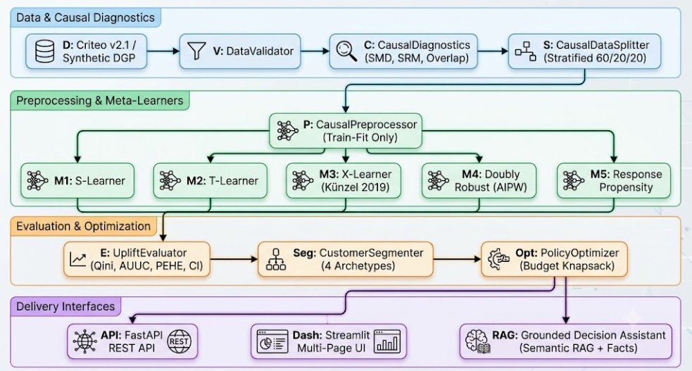
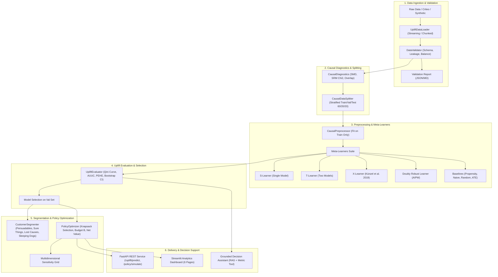

# System Architecture: DeltaCausal Engine

  

## Architectural Design Principles

1. **Strict Causal Framing**:
   The engine models individual potential outcomes $Y(0)$ and $Y(1)$ through Conditional Average Treatment Effects $\tau(x) = E[Y(1) - Y(0) | X=x]$. It estimates incremental effects, contrasting against traditional predictive propensity models that target organic buyers.

2. **Leakage-Free Transformation**:
   The `CausalPreprocessor` is fit exclusively on the training partition. Covariates, treatments, and outcomes are separated to prevent target leakage and post-treatment conditioning bias.

3. **Multi-Model Meta-Learner Portfolio**:
   Supports `SLearner`, `TLearner`, `XLearner` (specialized for imbalanced treatment/control allocations), and `DoublyRobustLearner` (AIPW pseudo-outcome regression).

4. **Mathematical Evaluation Suite**:
   Metrics account for treatment/control ratio scaling (`Qini Score`), ranking efficiency (`AUUC`), top-decile lift, and ground-truth CATE recovery (`PEHE`).

5. **Decision-Support RAG Layer**:
   Combines local semantic retrieval over verified causal methodology documentation with deterministic factual metric injection from actual experiment runs.

